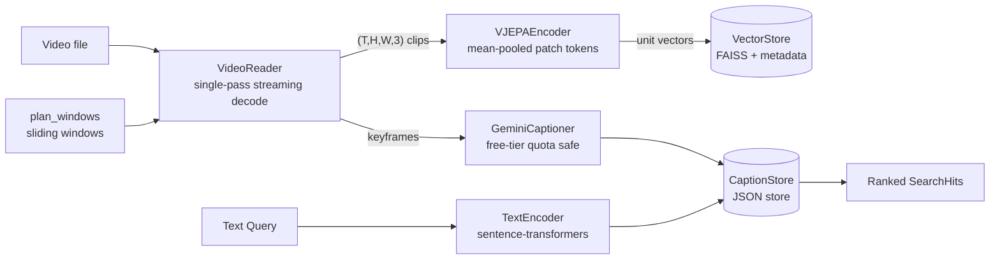

# LatentLens

**Video Q&A over the real world**: [V-JEPA 2](https://ai.meta.com/vjepa/) provides the visual memory and Gemini handles the language reasoning.
Every part of the stack is free: open-weight models, open-source libraries, and the Gemini free tier.

> **Status:** Phase 1 (Visual memory core) is complete. Phase 2 (Language bridge) is ~75% complete: free-tier plumbing, Gemini captioning pipeline, local text embeddings (`sentence-transformers`), and text-based clip search are done. See [ROADMAP.md](ROADMAP.md).

## Why V-JEPA?
V-JEPA learns by predicting *masked regions in latent space* instead of reconstructing pixels.
The result is embeddings that capture **motion and physical dynamics**, not just appearance.
That suits "what is happening" retrieval, and sending V-JEPA vectors to the LLM is far cheaper than sending raw video.

## Architecture



```
src/latentlens/
├── config.py          # pydantic-settings, LATENTLENS_* & GEMINI_API_KEY
├── types.py           # ClipSpan, SearchHit
├── video/
│   ├── segmenter.py   # pure window planning (no I/O)
│   ├── reader.py      # streaming OpenCV decoder + content fingerprint
│   └── keyframes.py   # keyframe selection & JPEG compression
├── encoders/
│   ├── base.py        # VideoEncoder and TextEncoder protocols
│   ├── text.py        # SentenceTransformerTextEncoder
│   └── vjepa.py       # V-JEPA 2 (Hugging Face transformers)
├── index/
│   ├── store.py       # FAISS vector store with atomic persistence
│   └── captions.py    # Persistent CaptionStore
├── llm/
│   ├── ratelimit.py   # Thread-safe sliding-window rate limiter
│   ├── cache.py       # Content-addressed response cache
│   └── captioner.py   # Gemini captioner with retries & backoff
├── pipeline/
│   ├── ingest.py      # Idempotent video ingestion
│   ├── caption.py     # Resumable keyframe captioning pipeline
│   └── search.py      # Visual moment search & text query search
└── cli.py             # Typer + Rich CLI
```

## Quickstart

```bash
python -m venv .venv && .venv\Scripts\activate      # Windows
pip install -e ".[dev]"

# 1. Ingest videos into visual memory (V-JEPA 2)
latentlens ingest path/to/videos/

# 2. Inspect index
latentlens stats

# 3. Caption indexed clips using Gemini free tier
latentlens caption --limit 20

# 4. Search by natural language query or by visual moment
latentlens search --text "person chopping vegetables" -k 5
latentlens search path/to/videos/cooking.mp4 --at 42 -k 5
```

Configure the tool through environment variables or `.env` (see [.env.example](.env.example)).
On CPU, ViT-L runs at roughly 1–3 s per clip. A free Colab or Kaggle GPU is about 20× faster.

## Development

```bash
pytest          # runs fully offline: fake encoder + synthetic videos
ruff check src tests
```

## Design notes
- **Single-pass decoding.** Overlapping windows share frames. Each frame is decoded once and routed to every window that needs it, and a window is released as soon as it is complete.
- **Idempotent ingestion.** Videos are identified by a content fingerprint, not by path. Renamed files are not re-indexed, and `--force` rebuilds them.
- **Embedding-space safety.** The index records the encoder name and dimension, so it refuses to mix vectors from different models.
- **Crash-safe persistence.** Writes are atomic (temp file + rename), with a checkpoint after every video.
- **Swappable backbones.** Anything that implements the `VideoEncoder` protocol plugs in. Phase 4 adds a CLIP baseline this way.

## License
MIT
