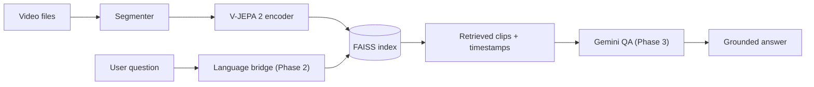

# LatentLens — Roadmap

> Video Q&A over the real world, powered by **V-JEPA 2** (visual memory) and **Gemini** (language reasoning).
> 100% free stack: open-weight models, open-source libraries, Gemini free tier.

| Phase | Theme | Status |
|------|-------|--------|
| 1 | Visual memory core | ✅ Done |
| 2 | Language bridge | ⏳ Next |
| 3 | Grounded video QA + UI | 🔜 |
| 4 | Evaluation & production | 🔜 |

---

## Phase 1 — Visual Memory Core ✅
Goal: turn any video library into a searchable latent memory.

- Streaming video decoder (single sequential pass, overlapping windows, bounded memory)
- Temporal segmenter (sliding windows with full tail coverage)
- `VideoEncoder` protocol + **V-JEPA 2** implementation (lazy-loaded, GPU/CPU auto)
- Persistent FAISS vector store with clip metadata and encoder-compatibility checks
- Idempotent ingestion (content fingerprinting, `--force` re-index)
- Moment-to-moment search ("find scenes that look/move like this one")
- Typer + Rich CLI, pydantic settings, pytest suite with a fake encoder (no GPU needed)

## Phase 2 — Language Bridge
Goal: let *text* reach the V-JEPA latent space (V-JEPA has no text tower).

- Gemini Flash (free tier) keyframe captioning with on-disk cache + rate limiter
- Text embeddings (`sentence-transformers`, free & local) for captions and queries
- Train a lightweight **projection head** (contrastive / InfoNCE) aligning V-JEPA ↔ text space on an MSR-VTT subset (Colab/Kaggle free GPU)
- Hybrid retrieval: latent-projection score + caption score fused via Reciprocal Rank Fusion

## Phase 3 — Grounded Video QA + UI
Goal: ask questions, get answers with timestamp citations.

- Retrieval-augmented prompting: top-k clips → captions + keyframes → Gemini
- Citation-enforced answers (`[video @ 00:12–00:16]`), refusal when evidence is weak
- Multi-turn conversation memory, query rewriting
- FastAPI backend + Gradio front-end with clip playback at cited timestamps

## Phase 4 — Evaluation & Production
Goal: prove it works and ship it.

- Benchmarks: Recall@K (MSR-VTT), QA accuracy (ActivityNet-QA subset)
- Ablations: V-JEPA vs CLIP vs raw-video-to-Gemini — accuracy, latency, token cost
- Docker image, GitHub Actions CI (lint, type-check, tests), Hugging Face Spaces deploy
- Structured logging, tracing, and a results report for the portfolio
